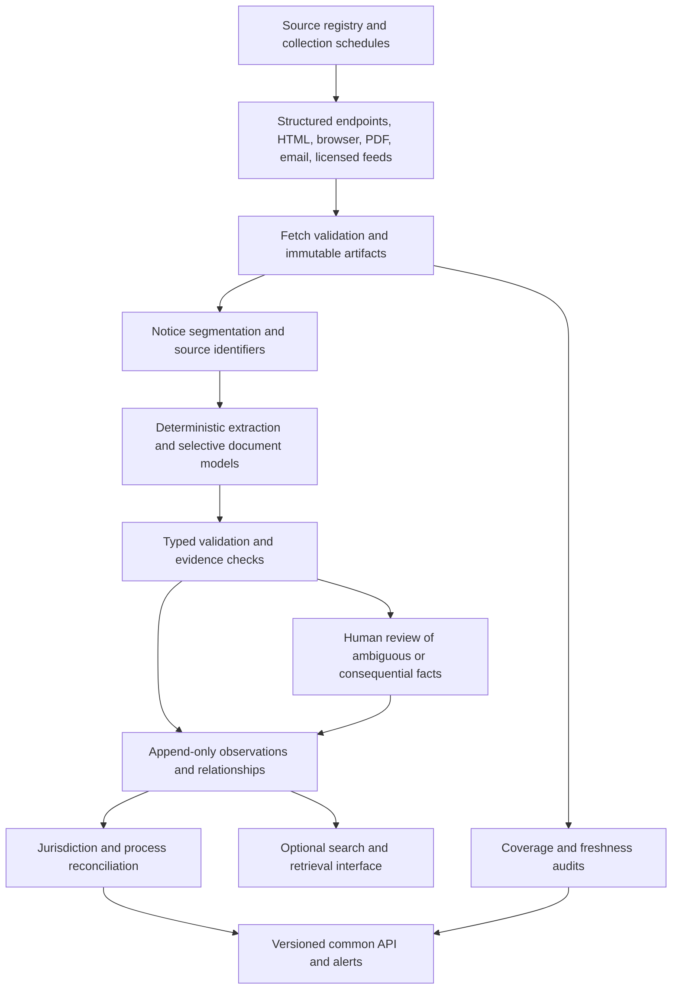

# Reliable state rulemaking data for DocketClock

Research date: September 30, 2026 UTC / September 29 Pacific.

This report independently audits the July Claude research and proposes a route from heterogeneous state sources to a common, trustworthy data service. It is a research recommendation, not an accepted architecture change. The existing federal service and ADR 0003 remain unchanged.

## Recommendation

Build a shared evidence and normalization platform with several collection methods and explicit coverage boundaries. Firecrawl can remove substantial acquisition work, and document tools such as LlamaParse merit evaluation. Neither service establishes that every relevant notice was discovered, that a date has the right legal meaning, or that a later event supersedes an earlier one.

The strongest near-term investment is a **source registry, a representative evaluation corpus, and a jurisdiction-neutral event model**. These let us add sources without rebuilding the product and judge quality without equating a successful scrape with a correct deadline.

The July research was useful reconnaissance. Its source lists are valuable leads. Its national difficulty counts, blanket absence claims, and suggestion that the existing contract transfers unchanged are insufficient grounds for a nationwide delivery commitment.

My most consequential findings:

- Connecticut exposes a working public JSON route for open comment periods. Inspecting the page implementation found more useful structure than the old API-versus-scraping classification captured.
- New Jersey's supposed statewide free PDF notice source has much narrower scope. The official site separately identifies a statewide active-proposal database and free, vendor-hosted Register access.
- A Washington issue's Proposed category includes a withdrawal; one filing also appears under multiple agencies. Index classification and row counts are not normalized event types or unique notice counts.
- The same Connecticut proceeding contains a closed 2025 comment period, a newly opened 2026 period, and an interim operational policy. A proceeding cannot be represented by one mutable deadline.
- Five difficult prompt-only extraction trials produced useful facts but also incorrect date roles, wrong deadline evidence, invented identifiers, and inconsistent output types. The results support selective extraction behind validation and review.

Detailed source observations and the claim-by-claim audit are in [audit findings](audit-findings.md). Machine-readable companions are [sources.json](sources.json), [jurisdictions.json](jurisdictions.json), [extraction-experiment.json](extraction-experiment.json), and four [worked normalization examples](normalization-examples.json). Seven transformed source snapshots and the inspected original PDF are retained in fixtures/.

## What was actually investigated

I read the four July documents at research commit [ae8eb9c](https://github.com/lucas-homer/yokel/tree/ae8eb9c98e3990775e08bc3d3fea978da703d3d5/docs/research/state-rulemaking), inspected the current shared contract and date reconciliation code, made 50 Firecrawl page/endpoint/document retrieval attempts, and ran 11 discovery searches. State-source inspection covered **19 states**: AL, AK, AR, CA, CT, GA, HI, IA, MA, MS, NE, NJ, NV, OR, SD, TN, UT, VA, and WA. Selection deliberately targeted publication diversity and questionable claims; it was not a representative statistical sample.

The retrieval count includes retries, vendor documentation, empty responses, and wrong routes. Forty-nine responses reported HTTP 200; several still contained a homepage, incomplete table, empty content, or a not-found page. This is direct evidence that HTTP success is an inadequate ingestion-health test.

I also ran five document-specific JSON extraction trials, inspected one Mississippi PDF visually, and compared its native text layer with Firecrawl's output. The Massachusetts and Tennessee PDFs were parsed through Firecrawl, but direct visual verification was blocked by a redirect loop and an HTTP 403 respectively. Those outcomes describe these retrieval paths, not universal access restrictions.

The 51-jurisdiction inventory preserves the July table as explicitly unverified historical input. Nineteen entries have fresh observations; **32, including DC, were not revalidated**. No subscriptions were created, paid datasets purchased, vendors contacted, production adapters built, or longitudinal monitoring performed. LlamaParse was assessed from its current documentation, not benchmarked. The experiment is diagnostic and cannot estimate nationwide accuracy or maintenance cost.

## Define the coverage promise first

The initial common product should cover administrative rulemaking proceedings: advance notices, proposals, comment opportunities, hearings, modifications, extensions, reopenings, withdrawals, adoptions, approvals, and effectiveness. These are related objects and events, not interchangeable documents.

Keep several adjacent universes separately identified:

| Universe | Why its inclusion changes the work |
|---|---|
| Administrative code currently in force | Useful for affected-section identity and checking outcomes; often omits pending proposals and expired participation opportunities. |
| Environmental and other permits | Frequently appear on agency sites and public-notice portals outside the rulemaking register. They need a separate source inventory and event profile. |
| Utility proceedings and adjudications | Docket systems may combine rulemaking with contested cases, tariffs, and other decisions. Classification is necessary before applying rulemaking semantics. |
| Guidance, operational policies, petitions, and periodic reviews | May offer participation without being an ordinary proposed-rule cycle. Preserve their type and authority. |
| Legislation and local government | Separate publication systems and scope. Open States' documented API covers legislative information; it is not the pending administrative-rule feed required here. |

For example, Alaska's portal contains procurements, permits, meetings, and regulations. A sampled regulatory notice announced an already-filed rule and an effective date while the extracted page also contained generic comment controls. A portal category or comment button alone does not establish an open comment opportunity. [Alaska notice](https://aws.state.ak.us/OnlinePublicNotices/Notices/View.aspx?id=225308), [Open States API](https://docs.openstates.org/api-v3/).

A useful coverage statement is: “proposed rules and subsequent participation changes for these agencies, under these processes, since this date, using these monitored sources.” “State covered” should be a derived summary with those limits visible.

## What the live sources imply

### Structured data is worth actively looking for

Connecticut's rendered Open for Comment page uses a first-party JSON endpoint:

[getOpenCommentPeriods](https://eregulations.ct.gov/eRegsPortal/Browse/getOpenCommentPeriods).

It returned five records with agency, tracking number, status, and a serialized comment-end timestamp. The page's script supplied the route; no endpoint was inferred or guessed. A retry with a three-second render delay and full-content extraction also exposed the five rows that the initial page extraction missed. These are two changed settings, so this experiment does not isolate which setting fixed the initial omission.

For PR2024-059, the endpoint timestamp decoded to October 3 at 03:00 UTC, or October 2 at 23:00 in America/New_York. The rendered detail page independently displayed October 2 at 11 PM. This checks the representation across two surfaces of the same system; it is **not independent legal corroboration**. The record also contains a 2025 closed period and a 2026 newly opened period. [Record and history](https://eregulations.ct.gov/eRegsPortal/Search/RMRView/PR2024-059).

Treat this route as an observed website backend, without an established support contract or guaranteed stability. Retain the rendered page and official document paths as verification/fallback surfaces. The narrow claim “no documented public statewide notice API was found” can coexist with useful public JSON, XML, and document endpoints.

Alabama illustrates why the word API alone is uninformative: a verified /api/aam/2026-04 route returned a PDF publication, not a normalized JSON notice stream. Its first three pages were inspected, not the full issue. [Alabama monthly](https://admincode.legislature.state.al.us/api/aam/2026-04).

### Registers help enumeration but do not settle semantics

Washington's Issue 26-18 exposes HTML and PDF links, agency groupings, and publication categories. Its Proposed section contained 14 rows but only 13 unique filing identifiers. WSR 26-18-058 is explicitly a withdrawal of the CR-102 portion of an earlier filing, with a new hearing and comment period promised later. It supplies neither new date. [Issue](https://lawfilesext.leg.wa.gov/law/wsr/2026/18/26-18.htm), [withdrawal](https://lawfilesext.leg.wa.gov/law/wsr/2026/18/26-18-058.htm).

California's monthly HTML contents expose more than PDF discovery: notice identifiers, proposed actions, corrections, petition decisions, decisions not to proceed, and references to older notices. This qualifies the July summary's shorthand that California has “no index”; its detailed appendix did already identify the HTML contents pages. The full notice still carries the operative details. The September contents also contain a visibly truncated notice identifier, so an index field must remain a candidate assertion until checked. [September contents](https://oal.ca.gov/september-2026-california-regulatory-notice-registers/).

Nevada's Daily Updates index has a useful document-type legend, but explicitly covers only the last four weeks. It is a change-discovery surface with an outage recovery requirement. A collector that resumes after a long interruption must reconcile against cumulative indexes and source documents. [Nevada index](https://www.leg.state.nv.us/Register/indexes/DailyUpdates.htm).

### Whole-state difficulty and agency difficulty are different

Georgia EPD has a readable table with hearings, comment deadlines, board-action dates, final decisions, and responses to comments. The same page describes an email service and at least 60 days of retention after final action. That is a strong bounded collection candidate inside a state the old report labels HARD. Some topic URLs recur across different rows and dates, so the URL cannot by itself identify a proceeding. [Georgia EPD](https://epd.georgia.gov/public-announcements-0/proposed-rules).

Georgia's central rules site describes a compilation of filed rules and advertises reseller XML source/update feeds through Fastcase. This is useful for code history and outcome checks; it does not prove a proposal-deadline stream. The presence of a commercial structured feed should be recorded alongside its actual scope. [Georgia central rules](https://rules.sos.ga.gov/).

Hawaii's central proposed-changes page currently functions as a department directory. The directory is useful; it does not itself enumerate dated proposal events. Its links require agency-level inspection. This supports a fragmentation concern without proving that no comprehensive solution exists elsewhere. [Hawaii directory](https://ltgov.hawaii.gov/the-office/administrative-rules/proposed-changes/).

### Access, format, completeness, and licensing are separate

Massachusetts' public notice page contains current agency notices and explicit written-comment dates and times. It supports the earlier finding of a useful free notice route. It does not, by itself, prove correspondence to every item in a paid Register issue. [Massachusetts notices](https://www.sec.state.ma.us/divisions/pubs-regs/public-hearings.htm).

New Jersey's official access page explicitly describes free online Register access through LexisNexis. Vendor hosting therefore should not be recorded as a paywall. Its OAL notices archive is dominated by OAL procedure rules, plus some broader historical notices; it does not establish the statewide substitute claimed in the July hard-states analysis. A separate official page describes the statewide active-proposal database. The Dynamics target could not be retrieved through the connector in this audit. [Access](https://www.nj.gov/oal/rules/accessp/), [OAL archive](https://www.nj.gov/oal/rules/proposals/archives.shtml), [statewide portal description](https://www.nj.gov/oal/rules/portal/).

Arkansas' official bulk-download page resolves another open question: the documented offering includes proposed rules and notices, with historical and monthly deliveries and per-record/image charges. Current file delivery and subscriber access were not tested. Monthly delivery would need supplementation for timely alerts. [Arkansas offering](https://www.sos.arkansas.gov/rules-regulations/bulk-data-download).

NASS ACR now advertises a 2026–2028 survey for $40, describing publication systems, responsible offices, and contact information. This is a promising primary-directory purchase to consider before spending much more on source rediscovery; it was not purchased or inspected. [Survey description](https://administrativerules.org/2026-2028-survey-for-sale/).

This audit did not establish that any entire state's rulemaking notices are available only in physical print or only through paid access. Keep those as source-level possibilities to investigate, rather than assigning whole states to those categories from old summaries. A physical notice, newspaper publication, emailed attachment, or licensed feed can enter the same artifact-and-observation model. Its acquisition method, delay, reproducibility, and reuse constraints need separate recording; Firecrawl cannot supply an unacquired physical document. A manual scanning or publisher-delivery process would be another collector, with its own measured service boundary.

## One schema should describe a process and its evidence

The common model should be a small set of related entities. Flattening an issue, proceeding, rule, and comment window into one record makes corrections and multi-stage processes unreliable.

| Entity | Purpose and relationships |
|---|---|
| Source | Publisher, jurisdiction and agency scope, process scope, access method, cadence, retention, source authority, and known gaps. One source can publish many artifacts. |
| Fetch attempt | Requested and final URL, acquisition settings, timestamps, status, content type, validation results, and failures. A successful empty result requires evidence of emptiness. |
| Artifact version | Immutable original bytes or payload, content hash, publisher identifiers, acquisition metadata, and relationships to prior versions or mirrors. |
| Proceeding | Stable identity for the regulatory action, potentially affecting multiple agencies and code sections. Contains stages and events rather than one mutable status date. |
| Regulatory instrument/version | The affected rule or code section and a particular proposed/adopted text version. A code citation is not a proceeding identifier. |
| Event | Proposal, modification, hearing notice, extension, reopening, withdrawal, adoption, approval, effectiveness, or another explicitly typed action. An event can affect multiple windows or rules. |
| Participation window | A specific opportunity and its audience, channel, time constraints, and evidence. Several windows can belong to one proceeding. |
| Hearing | Scheduled occurrence, location/remote access, time, cancellation or rescheduling, and relationship to participation opportunities. |
| Assertion/observation | A candidate fact with exact source location, parser/model/prompt versions, extraction method, and validation/review state. Append-only. |
| Relationship | Refers to, corrects, supersedes, withdraws, reopens, amends, or belongs to; with supporting evidence and uncertainty. |
| Published projection | Versioned current interpretation with supporting/contradicting observations and an explanation of changes. |
| Coverage assessment | What an adapter is expected to capture, what was checked, timeliness, missing-source risks, and the last coverage audit. |

Retain the existing federal identifiers. Add state identifiers through a versioned extension of the shared contract, with stable jurisdiction linkage using OCD divisions where appropriate. Do not invent an “official OCD” entity namespace. Public identity must survive host migration, agency renaming, URL changes, and replacement PDFs.

Use source-native proceeding IDs where present, namespaced by issuing system. Otherwise mint a stable internal identity once, retain all public aliases, and support reviewed merges and splits. Avoid using a text hash as identity: a corrected notice would become an unrelated object. Hashes identify artifact versions. A regulator, code citation, title, and time range are matching evidence, not automatically unique keys.

Keep original publication types and identifiers alongside normalized values. Washington PROP can map to several semantic event types after reading the notice. Preserve opaque source fields for replay while keeping shared concepts typed; a generic extras object must not become the only place essential facts live.

### Represent deadlines without fabricated precision

A deadline should carry:

- The source's original wording and location.
- Date, clock time, zone wording, interpreted IANA zone/offset, and precision as separate fields.
- Whether the condition is receipt, postmark, portal submission, in-person delivery, or another mechanism.
- Whether the boundary is inclusive, exclusive, relative to an event, or unresolved.
- For relative rules: anchor event, duration, calendar/business-day basis, calendar version, calculation-policy version, and review status.
- Whether each value is explicit, derived under an approved rule, disputed, or unknown.

An exact UTC instant is a **derived optional field**, available only when the inputs and interpretation warrant one. A date-only source should remain useful as a date-only deadline. It should not silently become 23:59:59 Eastern.

The Massachusetts sample states EST for an October event. Preserve that wording and flag the potential discrepancy with local daylight time. A reviewer or a tested jurisdiction policy must settle interpretation before publishing a supposedly precise UTC deadline. The Tennessee sample distinguishes hearing participation, written submissions before the hearing, and an accommodation-request period. Those constraints belong to different objects. [Massachusetts sample](https://www.sec.state.ma.us/divisions/pubs-regs/hearings/pdf/9-25-26-205-CMR-116.08-229.01-Notice-of-Public-Hearing-SOS.pdf), [Tennessee sample](https://publications.tnsosfiles.com/rules_filings/09-35-26.pdf).

### Preserve time and disagreement

Record publication time, source-reported modification time, first observation time, fetch time, and the time a fact becomes operative separately. Retain both what was known at an earlier moment and the latest interpretation. A correction published today may explain why yesterday's alert was wrong without making yesterday's evidence disappear.

Use source precedence by fact and process. A register may establish publication, an agency notice may announce an extension, and a review body may establish approval. Two copies of one notice are one evidentiary lineage. Agreement among two parsers, or among HTML and PDF renditions, is a consistency check rather than two independent legal sources.

Do not infer withdrawal from disappearance, adoption from a passed deadline, or an empty feed from a failed renderer. Preserve unknown states and make coverage deterioration operationally visible.

## Architecture that fits the existing project

Keep orchestration, retries, review queues, and projections in the existing TypeScript/Postgres stack unless measurements justify something else. A source registry and adapter interface are the reusable substrate; a new workflow engine or vector database is not required to establish the first reliable state feeds.

A source adapter should enumerate items, fetch artifact versions, emit source-native identity and structural metadata, and report health. Shared services handle deduplication, PDF processing, assertions, validation, and replay. Jurisdiction/process modules interpret legal stages and time conventions. This keeps collection changes separate from semantic changes.

The present contract is still federal-specific: ObservationSource enumerates federal services and human review, public IDs require a federal path, several fields name FR/Regs.gov, and date reconciliation binds FR dates to America/New_York. Preserve these behaviors for federal clients while introducing a new generic representation and compatibility projections. **The append-only design transfers; the current source enum, identity grammar, and date assumptions do not transfer unchanged.** See [contract](../../../packages/contracts/src/index.ts) and [date handling](../../../apps/docketclock/src/reconcile/eastern-date.ts).

## Where Firecrawl and LlamaIndex belong

**Firecrawl:** use it for discovery assistance, rendered acquisition, difficult pages, and PDF/OCR candidates. Its documented features include structured extraction and change tracking. All fresh acquisition tests here requested maxAge 0; the documentation lists a default cache allowance of two days, which would be unsuitable for many urgent deadline checks without explicit configuration. Change tracking should trigger a new observation, not decide the legal meaning of a change. [Firecrawl documentation](https://docs.firecrawl.dev/advanced-scraping-guide).

Prefer direct structured fetches or simple deterministic HTML parsing where they are stable and complete. They reduce cost, simplify diffing, and preserve fields such as IDs and timestamps. Use Firecrawl's more capable paths when they solve an observed collection problem. Archive original artifacts independently of cleaned Markdown, and test content type, final URL, expected headings, item counts, pagination, and representative selectors.

**LlamaIndex framework:** its TypeScript framework supplies connectors, retrieval, and workflow components. That could help build evidence search and extraction workflows within this repository's language stack. It remains an implementation option; it does not itself define a correct regulatory event model or prove source coverage. [Framework documentation](https://developers.llamaindex.ai/typescript/framework/).

**LlamaParse document services:** separately, the current hosted document platform documents Parse, Split, Extract, Classify, and Index. Splitting an issue into notices and extracting fields with page citations are directly relevant; retrieval is useful later for finding evidence and answering user questions. These capabilities overlap with Firecrawl, so compare them on the same retained corpus before paying for both on every document. No LlamaParse accuracy claim is established by this audit. [LlamaParse documentation](https://developers.llamaindex.ai/llamaparse/).

A retrieval system should help locate material and explain published facts. It should not independently answer “when does this close?” from arbitrary retrieved chunks while bypassing the reconciled projection. Deadline and lifecycle authority belongs in the typed data service.

**Commercial feeds:** State Net currently advertises XML and API delivery and nationwide regulatory tracking. It is a credible buy-or-partner option to evaluate against specific coverage, provenance, latency, corrections, and redistribution requirements. Marketing descriptions do not establish those properties for our use. A vendor's publication within 24 hours of collection also does not measure delay between agency publication and vendor collection. [State Net](https://www.lexisnexis.com/en-us/products/state-net.page).

## What the extraction experiment showed

The first attempt to supply a JSON Schema was rejected by the connector's argument validation. I then used the supported prompt-only JSON format, with the desired fields stated in the prompt. Thus these are **not tests of schema-constrained Firecrawl SDK extraction**, nor a comparison with LlamaParse. Expectations were recorded before the prompt-only runs. Each case ran once; there was no tuning against its result.

| Case | Useful result | Material problem |
|---|---|---|
| Washington withdrawal | Correct withdrawal classification and reference to the earlier filing. | Filing date populated the effective-date field even though no effective date was stated. |
| Alaska filed rule | Correct effective date; did not assign the generic comment controls a real closing date. | Unknown values were strings containing “null”; event type remained generic. |
| Massachusetts hearing | Correct stated comment and hearing dates/times, including literal EST. | Invented a document identifier, produced inconsistent field types, and did not flag the zone ambiguity. |
| Tennessee hearing | Correct hearing date/time. | Filing date became effective date; accommodation-request text was used as comment-deadline evidence. |
| Mississippi scanned form | Recognized a proposal and no scheduled oral proceeding. | Used the 20-day hearing-request period as the comment constraint instead of the separate 25-day comment period. |

These five cases were intentionally challenging. A percentage derived from them would be misleading. Their value is identifying failure classes that a production evaluation must test.

The Mississippi artifact had one scanned page and an imperfect embedded text layer. Native extraction omitted or corrupted useful details including the filing stamp. Firecrawl recovered more readable material, but the later semantic extraction still selected the wrong deadline clause. Better OCR and better semantic extraction are separate requirements.

## Quality needs separate measures

Track at least five dimensions for each source and published fact:

1. **Discovery coverage:** eligible notices found versus a defined independent reference set, with excluded agencies/processes named.
2. **Freshness:** distribution of agency-publication-to-discovery and discovery-to-DocketClock-publication delays, plus stale-source detection. Fetch time alone is not freshness.
3. **Field and event correctness:** correct date roles, time zones, affected entities, identifiers, lifecycle relations, and submission conditions.
4. **Evidence sufficiency:** reproducible source location, preserved version, known authority, and independence of corroboration.
5. **Operational continuity:** successful issue enumeration, pagination, replay, recovery from outages, and detection of silent content loss.

Keep extraction uncertainty, source disagreement, and incomplete coverage distinct internally. A simple user-facing confidence label can summarize them, but should preserve the explanation. Vendor model confidence is not a calibrated probability that a legal deadline is right.

Build an independently labeled corpus spanning normal proposals and difficult cases: extensions without republication, reopened periods, partial withdrawals, multiple rules in one notice, repeated URLs, amended PDFs, emergency procedures, adoption without advance comment, hearing-relative cutoffs, postmark/receipt differences, absent time zones, scanned checkboxes, and notices with no participation opportunity.

Split evaluation by time, agency, template, and source family so near-duplicate forms cannot leak from tuning into the held-out set. Evaluate segmentation, classification, entity linking, each deadline component, and final alert behavior separately. A citation that exists but supports the wrong field must fail.

Suggested pilot gates, to be agreed before implementation:

- Every published deadline has retained evidence and a reproducible derivation.
- Zero known unhandled critical failures in the regression corpus.
- At least 99.5% precision for published deadline assertions and 98% recall for eligible participation windows in the explicitly supported scope, on sufficiently sized held-out reference sets with counts and uncertainty intervals reported. Assess all material deadline components together; a correct date with the wrong submission condition fails. These are proposed targets, not achieved results or an SLA.
- Human review of every new-source deadline initially; automatic publication only for evaluated cases with adequate evidence.
- At least two complete publication cycles, recovery from an induced collection outage, and successful detection of changed/removed documents.
- A bounded review queue and a measured time-to-resolution compatible with the promised alert latency.

A register is not always an independent gold standard. For fragmented jurisdictions, construct the reference set from multiple official discovery routes and reconcile later adoptions back to proposals. Finals without observed proposals are audit candidates, not automatically misses: exemptions, emergency paths, pre-coverage history, and matching failures must be distinguished.

## A measured route to all 50 states

### First establish the inventory and reusable contract

Promote the 51-jurisdiction seed inventory into a maintained source registry. Resolve each state's source scope, primary publication mechanism, amendment channels, archive behavior, agency roster, and unsupported processes. Every unresolved lead remains marked unresolved. Use the ACR directory/survey and public rulemaking manuals to find responsible offices and authoritative channels.

Choose a small set of process types for the first public contract. Draft an ADR for state identifiers, temporal representation, source lineage, and federal compatibility before changing the production schema.

### Prove diversity in a bounded pilot

Use seven complementary jurisdictions/scopes:

| Scope | What it tests |
|---|---|
| Connecticut | Structured backend, dynamic page fallback, long-lived proceedings, multiple comment cycles. |
| Washington | Enumerated issues, HTML/PDF renditions, classification exceptions, duplicate index rows. |
| Massachusetts | Public notice listing, attached documents, explicit times, ambiguous zone wording. |
| Mississippi | Scanned forms, checkboxes, relative time conditions, weak discovery UI. |
| California | Mixed issue contents, agency corroboration, corrections and decisions not to proceed. |
| Nevada | Typed document sequences, short rolling index retention, backfill recovery. |
| Georgia EPD only | Agency-scoped coverage and proposal-to-decision tracking inside a fragmented state. |

Retain Alaska and Tennessee as required regression cases, even if they are not first-wave production scopes. This selection tests different failure modes; it does not designate seven states as fully covered.

Run collection in shadow mode through at least two source publication cycles, extending the observation period for monthly or low-volume sources. Compare discovered items and extracted fields to a manually reviewed reference set. Measure pages, parse time, source changes, review minutes, and misses. The audit supplies candidates, not an implementation-duration estimate.

### Expand by proven collection and process patterns

Once a family works, add sources sharing that structure, with source-specific acceptance checks. Expand geographically according to customer need and measured coverage cost. Maintain discovery and evaluation entries for all states even when only a funded subset has production guarantees.

In fragmented states, add agency cohorts and publish the agency roster. Do not wait for a fictitious uniform statewide API; do not silently label a few agency adapters as statewide coverage. The existing funded-jurisdiction gate can govern production rollout while national research and schema design proceed.

### Fund the maintenance system

The operating model needs clear ownership of adapter failures, ambiguous legal semantics, and customer-facing corrections. A mature nationwide service will require these responsibilities even if the absolute staffing level remains unmeasured.

Model cost as:

**collection requests + rendered pages + parsed pages + extraction tokens + review minutes + source maintenance + licensed data + storage/replay**.

Measure cost per timely, correctly normalized event and per reliable source-month. “Cost per state” obscures the number of agencies, revision frequency, document length, and guarantee being sold. The earlier estimate of a few hundred notices per week is not a capacity measurement; State Net's differently scoped marketing counts cannot substitute for one.

## Decisions this research supports now

1. Adopt the source-registry and evidence-first direction as the basis for a reviewable state design.
2. Treat Firecrawl as a useful acquisition and parsing component; keep semantic validation, provenance, and publication policy owned by DocketClock.
3. Evaluate LlamaParse on the retained difficult corpus before choosing document vendors.
4. Extend the shared model around proceedings, events, windows, relationships, and precision-aware time, preserving federal compatibility.
5. Validate a bounded, heterogeneous pilot before promoting state difficulty estimates into delivery commitments.

The main feasibility question is no longer whether disparate sources can be converted into text. The live tests show many can. The work to prove is whether we can **discover the right set of notices, preserve their meaning through changes, and publish timely facts with evidence and honest coverage limits**.
