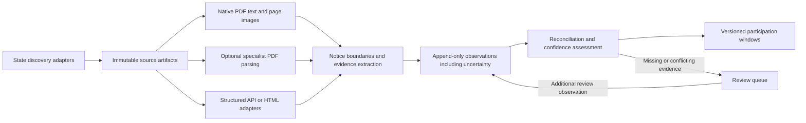

# Expanded state-document benchmark

> **Where the raw evidence lives.** This directory on `main` keeps the write-ups, specs, reviews
> and final results only. Source documents, parser outputs, model requests and responses,
> screenshots and per-run logs are preserved at the tag
> [`research/state-rulemaking-evidence-2026-10`](https://github.com/lucas-homer/yokel/tree/research/state-rulemaking-evidence-2026-10/docs/research).
> Paths mentioned in these documents that don't exist here resolve against that tag.

Completed October 6, 2026 Pacific. All 40 LlamaParse jobs are retained and reviewed alongside the 20 native-text and 20 Firecrawl outputs.

**LlamaParse Agentic is the strongest candidate for the PDF parsing path in this sample: 18 of 19 scorable notices pass, compared with 16 for Agentic Plus, 14 for native text, and 10 for Firecrawl PDF parsing.** Agentic also consumed fewer credits. This supports testing Agentic with preserved originals and native text; it does not establish national accuracy or justify treating generated Markdown as source truth.

1Password-backed API access on the Mini is working. The remaining 28 jobs completed without duplicate parsing of the 12 earlier jobs. No production adapter, shared contract, application, or cluster configuration was changed; the federal-only production constraint remains in place.

## What we expanded

The corpus contains **20 new notice units, eight states, and 34 parser-input pages**. The earlier Mississippi calibration document is excluded. Every parser was assigned identical retained PDF bytes. Source annotations and scoring rules were frozen before cloud parsing.

| Allocation bucket | Units | Examples |
| --- | ---: | --- |
| Scanned or filled forms | 5 | Mississippi image-only forms; Massachusetts filing forms |
| Clean standalone PDFs | 5 | California notices; North Carolina notices/forms |
| Dense register layouts | 5 | New York and Texas notices with neighboring material |
| Lifecycle changes | 5 | Washington withdrawals; Colorado terminations/adoption |

The states are Mississippi (3), Washington (2), California (3), New York (2), Massachusetts (2), North Carolina (2), Texas (3), and Colorado (3). Allocation buckets overlap with layout and event characteristics; for example, a clean North Carolina PDF still contains selection marks.

There are **16 distinct original PDFs**, eight named template families, and five units without a named template family. Four pairs share original publications. These are correlated examples, not 20 independent demonstrations of state coverage.

Collectors supplied 174 reference questions. Independent source review retained 142 critical questions: **118 determinate positive/explicit-negative facts, 23 not-stated questions, and one unresolved source conflict**. Related facets are also grouped into 125 determinate critical semantic groups. These are agent-reviewed references, not human gold labels.

## Results and denominators

“Strict pass” requires every predeclared critical question to preserve its decisive evidence, complete relevant scope for a not-stated answer, and no detected critical false assertion. A07 has contradictory dates in its source and is reference-insufficient for every arm. Thus there are 19 reference-eligible notices, within an all-scheduled denominator of 20.

| Measure | Native text | Firecrawl PDF parse | Llama Agentic | Llama Agentic Plus |
| --- | ---: | ---: | ---: | ---: |
| Nonempty outputs | 17/20 | 20/20 | 20/20 | 20/20 |
| Strict passes, all scheduled | 14/20 | 10/20 | 18/20 | 16/20 |
| Strict passes, reference-eligible | 14/19 | 10/19 | 18/19 | 16/19 |
| Positive critical evidence preserved | 91/118 | 109/118 | 117/118 | 114/118 |
| Complete-scope not-stated answers preserved | 22/23 | 17/23 | 23/23 | 23/23 |
| All facets of determinate critical groups preserved | 98/125 | 110/125 | 124/125 | 121/125 |

The group metric does not replace the strict notice gate: an additional false assertion can fail a notice even when all frozen field questions pass, as happened with A08 Plus.

The all-scheduled positive ratio is **evidence yield**, not extraction precision. Native's empty scan outputs leave 24 positive critical facts unrecovered. Among its 17 nonempty outputs, native preserves 91/94 positive critical facts. On **those same 17 notices**, Firecrawl preserves 89/94. Comparing native's 91/94 with Firecrawl's 109/118 would mix different document sets.

The paired document outcomes are: ten both pass; four native-only passes; two both fail for content; three native-empty/Firecrawl-content-fail scan cases; and one source-conflict case. There are no Firecrawl-only strict passes. That does not mean Firecrawl adds no value: it recovers 20 of 24 positive critical facts from the three image-only scans and recovers a selection relationship that native text loses in B04.

Of Firecrawl's nine content failures, **seven lose positive critical evidence**. Two, B04 and B10, fail the deliberately conservative complete-scope rule for not-stated answers because a stamp or footer is omitted. These two are not cases of an invented deadline. The distinction matters when interpreting the 10/19 strict-pass result.

No critical false assertion remains in the bounded native/Firecrawl review. Omissions and ambiguous selection relationships dominate the observed errors. This is not a measured claim of zero hallucination risk or exhaustive assertion precision.

| Allocation bucket | Native strict passes | Firecrawl strict passes |
| --- | ---: | ---: |
| Scanned/filled forms | 2/5; three empty | 2/5 |
| Clean standalone PDFs | 3/5; one source conflict | 3/5; one source conflict |
| Dense register layouts | 5/5 | 2/5 |
| Lifecycle changes | 4/5 | 3/5 |

The [machine-readable metrics](/Users/home/.codex/worktrees/e8f4/yokel/docs/research/state-rulemaking-benchmark/artifacts/review/results-completed-v1/primary-metrics.json) include state, layout, event, group, and paired breakdowns. The [notice matrix](/Users/home/.codex/worktrees/e8f4/yokel/docs/research/state-rulemaking-benchmark/NOTICE-MATRIX.md) shows every selected unit.

## Completed LlamaParse comparison

Agentic passes every eligible notice except A03. Plus fails A01, A03, and A08. Both tiers preserve A07's conflicting source dates, which cannot earn an unqualified pass. There are 16 paired passes, two Agentic-only passes, one paired content failure, and one reference-insufficient pair. There are no Plus-only strict passes.

- **A01: graphic evidence can disappear.** Plus replaces the filing stamp with `[image]`, losing the March 19, 2026 filing date; Agentic retains it. A submit date cannot substitute for a filing date even when they coincide.
- **A03: apparent correction can corrupt literal identity.** Both tiers change the title glyph `S` to `5`. A separate body reference to subpart `5` is faithful and was not scored as an error. Plus also omits the paragraph with the conditional oral-proceeding request and generic comment-period language. This benchmark preserves that language without interpreting it as a newly active comment window.
- **A04: specialist parsing recovers evidence missing from both simpler paths.** Both tiers retain the graphic current filing stamp, WSR 25-08-088, April 2, 2025, 8:56 AM. The body refers to a different, withdrawn notice.
- **A08: polished output can change meaning.** Plus adds Markdown strikethrough to the source's unstruck condition “If not re-adopted for an additional 90 days,” before a reversion date. All eight frozen critical field gates pass, but this additional alteration changes a temporal condition and fails the strict notice gate. Agentic preserves the condition.
- **B01–B10: both tiers pass all ten notices.** This includes forms, publication-relative deadlines, termination notices, and an adoption header. Passing the gate still does not mean complete or flawless transcription.

Two supplementary findings illustrate that last qualification. Agentic misreads A02's handwritten `28576` as `28574`; the number's semantic role was not established by the frozen reference, so this remains an unscored diagnostic. On B04, Agentic places `~~` around the exact citation inside a raw HTML table cell. Review initially treated this as a critical deletion, but independent adjudication found the citation still directly associated with the selected amendment and no established rendering behavior proving deletion. It is retained as a noncritical formatting defect, with the initial judgment and correction preserved in [correction history](/Users/home/.codex/worktrees/e8f4/yokel/docs/research/state-rulemaking-benchmark/artifacts/execution-dashboard-1/review-b/correction-history.json). This differs from A08's plain-Markdown deletion of an entire temporal condition.

Only retained Markdown was scored. Supplementary JSON did not repair missing evidence. Reviews used unchanged source references, exact quotations, and page inspection; the primary inspected material disagreements before integration.

## The failures that change the design

- **Scans: text recovery is not selection recovery.** Firecrawl recovers the Mississippi forms' text and filing stamps, but loses the decisive hearing-selection marks in all three. In A02 it also omits a selected proposed-effectiveness choice. Unselected labels surviving in Markdown cannot establish an active hearing or deadline. See the retained [A02 source](/Users/home/.codex/worktrees/e8f4/yokel/docs/research/state-rulemaking-benchmark/artifacts/source-a/A02/input.pdf) and [output](/Users/home/.codex/worktrees/e8f4/yokel/docs/research/state-rulemaking-benchmark/artifacts/firecrawl/recovery-1/A02/markdown.md).
- **A readable PDF can still need image evidence.** A04's withdrawal letter has embedded body text and a graphic filing stamp. Both native extraction and Firecrawl omit the current notice ID and filing clock in the stamp. The withdrawn notice's ID and the letter date are different facts. See [source](/Users/home/.codex/worktrees/e8f4/yokel/docs/research/state-rulemaking-benchmark/artifacts/source-a/A04/input.pdf), [native text](/Users/home/.codex/worktrees/e8f4/yokel/docs/research/state-rulemaking-benchmark/artifacts/source-a/A04/native.txt), and [Firecrawl output](/Users/home/.codex/worktrees/e8f4/yokel/docs/research/state-rulemaking-benchmark/artifacts/firecrawl/recovery-1/A04/markdown.md).
- **An apparently cleaner representation can lose identity.** A09's New York notice ID `SGC-39-26-00023-P` appears in the source and native text but disappears from Firecrawl's output. A neighboring notice ID survives; borrowing it would create the wrong record. See [source](/Users/home/.codex/worktrees/e8f4/yokel/docs/research/state-rulemaking-benchmark/artifacts/source-a/A09/input.pdf), [native text](/Users/home/.codex/worktrees/e8f4/yokel/docs/research/state-rulemaking-benchmark/artifacts/source-a/A09/native.txt), and [Firecrawl output](/Users/home/.codex/worktrees/e8f4/yokel/docs/research/state-rulemaking-benchmark/artifacts/firecrawl/recovery-1/A09/markdown.md).
- **Publication context is evidence.** B06 and B07 lose publication footers under Firecrawl, even with `onlyMainContent=false`. Their comment periods are tied to publication, so filing or earliest-adoption dates cannot substitute. The retained [B06](/Users/home/.codex/worktrees/e8f4/yokel/docs/research/state-rulemaking-benchmark/artifacts/source-b/B06/input.pdf) and [B07](/Users/home/.codex/worktrees/e8f4/yokel/docs/research/state-rulemaking-benchmark/artifacts/source-b/B07/input.pdf) source pages show the missing context.
- **Parsers are complementary within a single document.** In B04, Firecrawl correctly associates the selected amendment mark; native text detaches the `X`. But Firecrawl omits the filing stamp, which prevents certifying complete scope for the frozen absence questions. Neither representation alone passes the strict gate. See [source](/Users/home/.codex/worktrees/e8f4/yokel/docs/research/state-rulemaking-benchmark/artifacts/source-b/B04/input.pdf) and the field ledger.
- **Faithful parsing cannot resolve a contradictory publisher source.** A07 prints different years for the original notice on its two pages. It remains unresolved; a parser that preserves both dates should not be credited with knowing which is correct. See [source](/Users/home/.codex/worktrees/e8f4/yokel/docs/research/state-rulemaking-benchmark/artifacts/source-a/A07/input.pdf).

## What this implies for DocketClock

For a future customer-funded state expansion, my recommendation is to keep **one evidence and normalization pipeline with several acquisition and parsing paths**. This research does not lift the repository's federal-only production constraint. Parser selection belongs inside the pipeline; it should not determine what counts as source truth.



1. **Preserve originals and native text by default.** Every acquired artifact gets its source URL, retrieval time, hash, and relationship to the notice/package. Keep parser outputs as additional versioned artifacts. The native channel rescued evidence lost during cloud parsing in this sample.
2. **Route using both document features and evidence gaps.** Empty embedded text clearly requires OCR. Forms, stamps, columns, and unexplained gaps in expected IDs or publication context require additional scrutiny even when abundant text exists. A routing rule learned from these 20 examples still needs held-out validation.
3. **Give a specialist parser the retained PDF input, with provenance to the full original.** Running LlamaParse on already flattened Firecrawl Markdown cannot restore a checkbox or stamp that the Markdown omitted. Retain both representations and their provenance; do not silently merge conflicting claims. This study used bounded inputs and did not test full-register parsing.
4. **Normalize claims with their role and scope.** A filing date, publication date, hearing, proposed effective date, and comment close are distinct. Record literal values, stated precision, unknown time zones, relative anchors, selected states, and evidence locations. Distinguish “not stated in the retained notice” from “no such event exists.” Append observations before review, including uncertainty; a review adds evidence rather than rewriting history. Only a separate, versioned reconciliation layer should derive a participation window, preserving unknown or conflicting states.
5. **Make operational recovery part of the ingestion design.** Persist job IDs and submission state, pace all endpoint requests, resume known jobs, and distinguish a timeout from a rejected request. A synchronous connector that returns neither a result nor a job ID is insufficient as the production job-control interface.

For the next PDF pilot, use **Agentic as the default specialist candidate**, retain native text, and send missing or conflicting decisive evidence to review. This sample provides no justification for automatically upgrading every failure to Plus: Plus did not rescue a strict failure of Agentic and introduced additional failures. Routing and reconciliation still require held-out validation.

Firecrawl remains a possible acquisition tool for HTML and document discovery; this PDF experiment does not measure those uses. Give LlamaParse the original PDF, not Firecrawl's flattened Markdown. Nothing here tests LlamaIndex retrieval or demonstrates that it is needed to normalize observations.

The next measurement should test the actual normalization step on held-out notices: correct notice identity and event linkage; separation of publication, filing, hearing and deadline roles; relative-date anchors; evidence locations; and correct abstention/review behavior. Split by template or publication family to limit leakage. Separately test discovery and segmentation against complete registers with a source inventory, because excellent selected-document parsing cannot detect notices never acquired.

## Operations, cost, and measurement limits

Firecrawl returned 14 notices on the first provider attempt. Six explicit rate-limit rejections succeeded on one authorized recovery each after pacing setup and parse requests together. Four earlier local stdin failures occurred before any upload or final parse; those were repaired and retained separately. Across all phases there were 30 setup requests, 24 successful uploads, and 24 final parse requests. No uncertain submitted parse was retried.

LlamaParse initially uploaded A01 and A02 once each. Both tiers timed out for both inputs: four connector calls, no content returned through the connector, 36 planned calls unattempted at that stop. The lane stopped at the third completed failure and retained its already-running fourth call. After user sign-in, read-only dashboard recovery confirmed all four service jobs completed, recovered their outputs, and matched their 110-credit usage subtotal. Recovery itself created no new jobs or credentials. The separate dashboard continuation subsequently completed eight new jobs. The dashboard says results are stored for 48 hours, making prompt result retention necessary.

Successful Firecrawl responses report **34 credits**, a subtotal rather than proven total billing; setup and failed-call charges were not returned. The recorded successful parse-wrapper median is 3.269 seconds, range 0.720–10.063 seconds. Some timestamps precede pacing waits, so these are wrapper/pacing-inclusive measurements, not isolated API latency or production throughput.

**All 40 LlamaParse jobs report usage: 1,870 credits total**, comprising 340 Agentic and 1,530 Plus credits for the same 34 pages per tier. Plus consumed 4.5 times the credits. Historical jobs account for 315 credits; the final 28 REST jobs account for 1,555. These are returned job-usage values, not a cash invoice or proof of all account charges. Firecrawl and LlamaParse credits are not interchangeable. See the [per-job reconciliation](/Users/home/.codex/worktrees/e8f4/yokel/docs/research/state-rulemaking-benchmark/artifacts/execution-api-1/operations-review/full40-usage.json).

The execution used four original connector jobs recovered without resubmission, eight dashboard jobs, and 28 REST jobs. The REST run preserved exact input hashes, whole returned Markdown, durable job IDs, a maximum of two active jobs, and a pair barrier before the next submission. All completed successfully. A read-only refresh obtained usage and backend timing for the historical jobs without reparsing.

Configuration equivalence is not established across those interfaces. Dashboard screenshots were enabled; legacy OCR/header/footer controls had no verified REST mapping and were omitted. Requests used `latest` without an exposed resolved release. Interfaces, dates, and configurations therefore limit causal claims about tier superiority. Parser breakdowns, queue/processing time, HTTP latency, and wrapper elapsed time remain distinct; no production throughput estimate is claimed.

The Firecrawl full API documents per-page output, layout blocks, and OCR controls beyond those exposed by the installed connector. LlamaParse also documents layout/form options outside the callable settings used here. Those configurations remain untested; these findings apply to the captured connector requests, not every configuration the vendors offer. [Firecrawl parse documentation](https://docs.firecrawl.dev/features/parse), [LlamaParse forms](https://developers.llamaindex.ai/llamaparse/parse/features/forms-and-checkboxes/).

## Why this is not yet a national quality estimate

The sample is purposive, small, and clustered by state/template. We selected complete short notices or bounded unchanged-page excerpts before parsing. **The 16 full originals total 3,042 pages; only 34 selected page instances were submitted.** This does not measure automatic discovery, whole-register segmentation, missing attachments, ongoing update detection, access behind paid systems, or production cost per monitored state. B10 deliberately covers an adoption header, not its attached rule text.

Reference review also made mistakes. Pre-freeze checks corrected a source transcription and rejected a mistaken claim that A10 lacked a visible header. During scoring, the primary caught a false A03 error allegation caused by conflating a title glyph with a different body numeral. The initial judgment and correction are retained; frozen reference files were not silently edited. Human adjudication of disputed scans remains a sensible requirement before operational use.

## Verification and retained evidence

The final strict merge verifies **141 frozen artifacts, 696 completed field rows, 80 document-arm rows, 662 exact output quotes, 80 output artifacts, and all 80 recomputed gates**. Original native/Firecrawl rows and the historical Llama timeout records remain intact. Quote checks establish retained evidence, not independent semantic truth.

The final REST operations audit passed **779 checks**, covering the 28 new jobs, all 40 usage records, inputs, output hashes, page counts, duplicate avoidance and concurrency. All 629 files in the original retention manifest remain unchanged. The earlier Firecrawl audit's 151/152 result remains disclosed: one setup request began 17 ms after the recorded third failure, so unconditional historical stop-rule compliance cannot be claimed. That request was rate-rejected and later explicitly recovered. The new REST runner used a pair barrier; no live REST failures occurred, so its failure-stop behavior was checked offline rather than exercised by this run.

- [Final metrics](/Users/home/.codex/worktrees/e8f4/yokel/docs/research/state-rulemaking-benchmark/artifacts/review/results-completed-v1/primary-metrics.json), [verification](/Users/home/.codex/worktrees/e8f4/yokel/docs/research/state-rulemaking-benchmark/artifacts/review/results-completed-v1/primary-verification.json), [field ledger](/Users/home/.codex/worktrees/e8f4/yokel/docs/research/state-rulemaking-benchmark/artifacts/review/results-completed-v1/field-scores.jsonl), and [document ledger](/Users/home/.codex/worktrees/e8f4/yokel/docs/research/state-rulemaking-benchmark/artifacts/review/results-completed-v1/document-scores.jsonl).
- [Notice matrix](/Users/home/.codex/worktrees/e8f4/yokel/docs/research/state-rulemaking-benchmark/NOTICE-MATRIX.md), [protocol](/Users/home/.codex/worktrees/e8f4/yokel/docs/research/state-rulemaking-benchmark/PROTOCOL.md), and [frozen corpus](/Users/home/.codex/worktrees/e8f4/yokel/docs/research/state-rulemaking-benchmark/artifacts/corpus-freeze.json).
- [Final operations audit](/Users/home/.codex/worktrees/e8f4/yokel/docs/research/state-rulemaking-benchmark/artifacts/execution-api-1/operations-review/FINAL-REPORT.md), [original operations audit](/Users/home/.codex/worktrees/e8f4/yokel/docs/research/state-rulemaking-benchmark/artifacts/operations-review/FINAL-REPORT.md), and [historical recovery manifest](/Users/home/.codex/worktrees/e8f4/yokel/docs/research/state-rulemaking-benchmark/artifacts/llama-recovery-2026-10-05/recovery-manifest.json).
- [A03–A10 review](/Users/home/.codex/worktrees/e8f4/yokel/docs/research/state-rulemaking-benchmark/artifacts/execution-dashboard-1/review-a/findings.json), [B01–B10 correction history](/Users/home/.codex/worktrees/e8f4/yokel/docs/research/state-rulemaking-benchmark/artifacts/execution-dashboard-1/review-b/correction-history.json), and [merge provenance](/Users/home/.codex/worktrees/e8f4/yokel/docs/research/state-rulemaking-benchmark/artifacts/review/results-completed-v1/merge-metadata.json).
- [API runner instructions](/Users/home/.codex/worktrees/e8f4/yokel/docs/research/state-rulemaking-benchmark/API-RUNNER.md). Credentials were injected from 1Password at runtime; no key is embedded in the runner or report. No further provider jobs are needed for this comparison.

Original PDFs, exact inputs, native text, page images, annotations, cloud responses and job receipts are retained under `artifacts/`. Original PDFs are deduplicated using relative links to `pdf-blobs/`.

Offline verification from this directory:

```sh
python3 merge_dashboard_results.py artifacts --check-only
python3 verify_recovery.py
```

These commands validate the complete overlays and original retention without submitting vendor jobs. The final merged results live under `artifacts/review/results-completed-v1`; older aggregate directories are historical snapshots.
