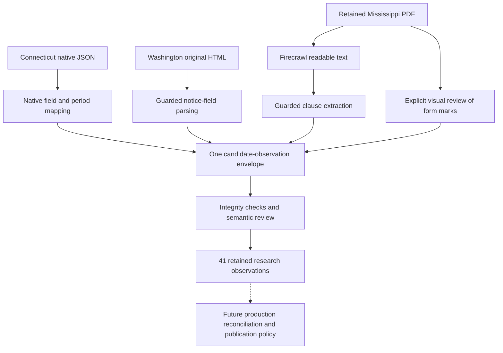

# Three collection paths into one DocketClock observation format

Research completed October 5, 2026. This is a reproducible, offline integration
spike using selected public-source examples. It is a research result, not an
accepted production contract or a claim of statewide coverage.

Later on October 5, the requested [LlamaParse comparison](llamaparse-comparison/README.md)
ran on the same retained Mississippi PDF. That follow-up is separate from the
41-observation baseline below and preserves its original results.

## Result

**All three paths produce one typed, evidence-linked candidate-observation
stream.** The final output contains **41 observations backed by 37 retained
artifacts**. Thirty-seven observations are normalized by deterministic code
from saved inputs; four are explicitly labeled agent-manual visual findings.
Model JSON trial outputs are retained separately and contribute no assertions
to the accepted research stream.

| Path | Final observations | What worked | What still needs judgment |
|---|---:|---|---|
| Connecticut public JSON and rendered detail | 23 | Native fields and period GUIDs; explicit timestamp decoding; distinct historical comment cycles | Supported endpoint contract, current-window identity, source clock/legal-time interpretation |
| Washington HTML notices | 10 | Direct HTML parsing of a proposal and partial withdrawal; native filing IDs; labeled date roles | New template variants, partial-withdrawal semantics, timezone and submission conventions |
| Mississippi scanned notice form | 8 | Firecrawl improved text recovery; guarded clause parsing separated 20-day and 25-day conditions | Checkbox evidence, visual findings, hearing-request eligibility, unresolved relative-date calculation |

The common output is [observations.json](observations.json), described by
[SPEC.md](SPEC.md) and [observation.schema.json](observation.schema.json).
[artifacts.json](artifacts.json) resolves every evidence reference to a retained
file, source URL, representation and hash. [validation-report.json](validation-report.json)
records the actual offline integrity/replay checks. The common validator is a
purpose-built standard-library checker, not a full JSON Schema engine or an
automatic semantic-entailment test.

## What this changes about the proposed solution

Use **direct structured collection where available**, **deterministic HTML
extraction where the source supports it**, and **document processing selectively
for sources that need it**. Keep the artifact store, observation envelope,
temporal types, evidence checks and review state shared.

Firecrawl earned a role in rendering and document conversion. The sampled CT and
WA facts did not require model field extraction. The PDF remains the strongest
candidate for a LlamaParse/LlamaExtract comparison, particularly for form marks
and field-level evidence. No usable LlamaParse connector or credential was
exposed in this session, so LlamaParse was **not executed or ranked**. LlamaIndex
was not required to run this small offline pipeline; this does not establish
that it would be unsuitable for larger retrieval/workflow needs.



The experiment stops at reviewed candidate observations. A versioned production
projection, reliable longitudinal identity, jurisdiction policies and coverage
monitoring remain separate work. The existing federal contract contains federal
source enums, identifier grammar and date assumptions; these research records
are not silently inserted into it. See [current contract](../../../packages/contracts/src/index.ts).

## Connecticut: structured data is more useful than the rendered page

The [open-comment endpoint](https://eregulations.ct.gov/eRegsPortal/Browse/getOpenCommentPeriods)
returned four records. PR2024-059, present in the September audit, had disappeared.
The child followed endpoint wiring in the original detail HTML and fetched
[native history](https://eregulations.ct.gov/eRegsPortal/Search/getRMRHistory?trackingNumber=PR2024-059).
It contains two distinct comment-period GUIDs and explicit start/end timestamps.

The two historical closes decode to March 28, 2025 at 03:00Z and October 3, 2026
at 03:00Z. They stay attached to different windows. The portal also explicitly
records closed events; disappearance from the open list supplies no lifecycle
inference by itself. The native source's exact opening clocks retain fractional
seconds; their legal significance was not established merely by decoding them.

The current Taxi proceeding, PR2026-014, provides a close timestamp of
October 12 at 03:45Z. Its rendered detail says October 11 at 11:45 PM. Both
representations are preserved. The rendered page does not state a timezone, so
that observation retains a null zone and UTC instant. The two surfaces share
one publisher/backend lineage and are not independent corroboration.

Firecrawl initially returned HTTP 200 with an incomplete detail shell. Changing
both the render wait and full-content setting recovered the data. The test does
not isolate which setting mattered. For the demonstrated open-list and historical
window fields, direct JSON already supplies better structure and identity.

One remaining weakness is explicit: the open-list route lacks a period GUID, so
those window identities are provisional and snapshot-specific. They are not a
production identity strategy. Current-history collection and extension/reopening
tests should resolve this before an adapter publishes longitudinal records.

Details and execution records: [CT notes](ct/NOTES.md), [CT results](ct/results.json).

## Washington: clean HTML can support a small deterministic adapter

The [sample issue](https://lawfilesext.leg.wa.gov/law/wsr/2026/18/26-18.htm)
contains 14 PROP rows representing 13 unique filing IDs. Its PROP category
includes [WSR 26-18-058](https://lawfilesext.leg.wa.gov/law/wsr/2026/18/26-18-058.htm),
which withdraws only the CR-102 portion of WSR 26-15-113. The body promises a later
hearing/comment period without assigning dates. The output preserves the target
and limited scope; no future close or effective date is fabricated.

The positive case, [WSR 26-18-032](https://lawfilesext.leg.wa.gov/law/wsr/2026/18/26-18-032.htm),
supplies a written-comment deadline of October 9 and a hearing on October 15 at
09:00. The comment date stays date-only. The hearing and filing clocks keep
unresolved zones. Intended adoption, accommodation timing and old amendment
effective dates are not substituted for these fields.

Native HTML includes labeled sections and field markers. The adapter handles
the observed agency name spanning multiple divs and rejects unsupported notice
headers or a missing required comment-field label. Firecrawl provides readable
inspection text, but did not demonstrate an essential operational benefit for
these two known templates. Its prompt-only JSON trial correctly recognized the
partial withdrawal, yet represented absent values as literal strings containing
null. The raw result is kept separate from normalized data.

Details: [WA notes](wa/NOTES.md), [WA results](wa/results.json).

## Mississippi: better OCR still needs field-level evidence

The [original official form](https://www.sos.ms.gov/adminsearch/ACProposed/00027305a.pdf)
is one scanned page with an imperfect embedded text layer. A fresh direct fetch
matched the retained original byte-for-byte. Native text extraction loses useful
stamp/mark information and damages some words; Firecrawl improves readability,
recovers the filing stamp and exposes an amendment mark.

Its transformed Markdown does not reliably preserve which oral-proceeding
checkbox is selected, and includes economic-impact alternatives without their
marks. The complete saved image was therefore inspected. Proposal, amendment
action, no hearing scheduled, and filing date are four **agent-manual visual**
observations, with a saved review note and image/original hashes. Deterministic
normalization of Firecrawl output does not make the underlying vendor parsing
deterministic.

The two relative conditions remain separate:

- Hearing request: 20 days after filing, with the condition involving a political
  subdivision, an agency, or ten or more persons retained in evidence and a scope
  warning. Eligibility is not yet a separately typed field.
- Written comments: a 25-day public-comment period. The excerpt does not resolve
  the anchor and counting policy needed for an approved computed deadline.

Neither condition becomes an absolute closing date. Blank final-action and
effective-date options produce no assertions. The PDF says a full rule is
attached, but this one-page file does not contain it; complete-package discovery
was not tested.

The fresh prompt-only model trial separated the two durations correctly and
abstained from fabricated close/effective dates. It still returned string
unknowns, lacked field-by-field evidence mapping, and two of four offered quotes
were not exact substrings of the separately retained parse. That is not proof
of fabricated source text: the extraction call may use its own document
representation. It is a failure to supply reproducible citations against the
retained comparison artifact. A matching hearing-status answer alone also does
not establish checkbox-grounding reliability.

This differs from the earlier exploratory trial, which confused the durations.
The prompt and run differ; the result does not establish a measured improvement
or repeatable accuracy. A useful LlamaParse trial must compare form-mark
association, stamped dates, exact per-field evidence, and abstention using these
same original bytes.

Details: [PDF notes](pdf/NOTES.md), [PDF results](pdf/results.json),
[retained original](pdf/raw/fresh.pdf).

## What remains source-specific

| Shared across all three paths | Source/process-specific work |
|---|---|
| Artifact versions, hashes, URLs and lineage | Enumeration routes, rendering settings, pagination and retention |
| Candidate assertion envelope and canonical event vocabulary | CT serialized epochs and period GUIDs; WA field markers; MS form clauses/marks |
| Date-only, instant, local-time and relative-duration types | Authority for timezone, relative-date anchors, eligibility and receipt rules |
| Evidence references and explicit manual/model/deterministic methods | Identifying the passage or visual region that supports each fact |
| Replay, validation and review state | Mapping proposals, partial withdrawals, reopenings and replacements to stable entities |

The shared envelope is useful, but identity and relationships are not solved by
making fields look alike. The next contract design needs explicit proceeding,
notice, instrument and window relationships; source-record IDs here remain
research identities with disclosed limitations.

## Verification, corrections and limits

Three separate Codex child tasks produced the lanes, followed by an independent
GPT-6 Astra review task. Model selections and task IDs are in
[task-coordination.json](task-coordination.json). The primary inspected the
normalizers, the PDF image and material facts, then integrated the retained
artifacts and ran the shared replay. The reviewer used isolated copies for
mutations and repeatability checks. These are agent inspections, not an
independent human gold standard.

Corrections made during integration:

1. Removed five CT Posted Date assertions incorrectly typed as comment boundaries.
   Their dates looked plausible and their quotes were exact; the semantic role
   was still wrong. A mutation now changes the posting date without changing
   the normalized historical deadline.
2. Standardized proposal/withdrawal vocabulary and separated proposal from the
   amendment rule action. Source labels remain in evidence.
3. Changed missing required PDF clauses from silent partial success into an
   explicit failed/review outcome, with partial observations marked needs_review.
4. Corrected unsupported human-inspection wording and retained the conditional
   hearing-request scope with its normalized duration.

The shared integrity check verifies hashes and quote presence. It does not prove
that a quote entails the assigned field or that a free-text locator is correct.
The independent review resolves CT native JSON pointers and conversions, checks
the selected WA date roles and partial scope, and inspects the PDF image/lineage.
Its synthetic probes deliberately show that wrong date roles and enlarged
withdrawal scope can pass generic shape/quote checks. Some provenance-value,
timezone-consistency, missing-visual-note and malformed-input checks are also
outside this small validator's current enforcement; actual fixture provenance
and unresolved zones were inspected separately. See [review record](review/REVIEW.md).

Some local derivatives have no retrieval timestamp because no network retrieval
occurred when they were produced. Source URLs and lineage still refer to the
captured parent material. Other timestamps are server Date values, file-save
times or minute-rounded acquisition estimates, with those bases described by the
lane notes. They do not establish publication-to-discovery latency.

Eight Firecrawl calls reported **16 credits total**: CT 3, WA 7, PDF 6. These
counts include rendering comparisons and two prompt-only extraction trials.
Single-call timings/credits are not a production cost or vendor ranking. There
was no blind holdout, longitudinal monitoring, nationwide discovery test or
LlamaParse execution. The original sources and intermediate representations are
retained so the next comparison can reuse the same evidence.

## Reproduce and continue

From this directory, run:

```sh
python3 -B replay.py
python3 -B review/audit_lanes.py . ./validate.py
python3 -B review/adversarial.py ./validate.py
```

The replay uses saved artifacts and Python's standard library. It verifies inputs,
replays each normalizer, rejects changed output, and rebuilds the combined JSON
and validation report. Review probes create only temporary isolated copies.
No network access, installation, application build or production database is
needed. The formal JSON Schema is supplied for future consumers; the built-in
replay uses the named purpose-built validator.

The next bounded experiment should add unseen notices to the CT/WA paths and
run the difficult PDF corpus through an actually accessible competing document
service. Measure field support, abstentions and review work before selecting a
default vendor or extending production coverage. State adapters and a production
contract still pass through the repository's funded-jurisdiction and ADR gates.
