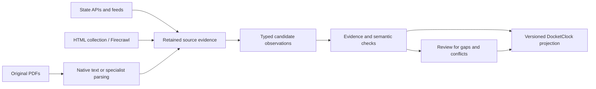

# LlamaParse comparison on the Mississippi notice

Trial conducted October 5, 2026 Pacific time, continuing the [three-path spike](../README.md). Two existing, user-visible Codex child tasks ran the trial and independently reviewed it. No production contract or adapter changed.

**LlamaParse demonstrated a useful but partial benefit on this scanned form.** Both tested tiers preserved checkbox states that the retained Firecrawl markdown lost. Both also omitted the official filing-stamp date that Firecrawl recovered. The separate vendor schema-extraction call timed out without returning an extraction result.

The evidence supports a specialist parsing path with explicit completeness and review gates. It does not support a general vendor ranking or unattended publication.

## Same source, separate stages

The fixture is the [Mississippi Secretary of State notice for Rule 5.29](https://www.sos.ms.gov/adminsearch/ACProposed/00027305a.pdf): a scanned, one-page form with an imperfect embedded text layer. The original PDF bytes were uploaded to LlamaParse, rather than feeding it Firecrawl's transformed markdown. The retained original is 401,742 bytes, SHA-256 `ac95c240653690261eb7a6fef83bd80a04310cf49c15c37256569bbc70315955`. The server returned a file ID, but no independently reported file digest.

The comparison retains native text, the earlier Firecrawl parse and prompt-only JSON trial, two new LlamaParse markdown results, and the failed extraction call. The new parse calls requested `agentic/latest` and `agentic_plus/latest`. The higher tier was tried after the first output omitted a critical date; it is an adaptive follow-up, not a blinded comparison. The reviewer froze a [12-case rubric](review/RUBRIC.md) before inspecting new outputs.

| Distinction in the original | Firecrawl markdown | LlamaParse Agentic | LlamaParse Agentic Plus |
|---|---|---|---|
| Amendment is selected | X beside amendment | `[x]` beside amendment | Explicit checked amendment; other actions unchecked |
| Oral hearing is not scheduled | Both options, selection lost | Selected and unselected options distinguished | Selected and unselected options distinguished |
| Economic statement is not required | Both options, selection lost | Selected and unselected options distinguished | Selected and unselected options distinguished |
| Handwritten submit date, 12/27/2023 | Recovered | Recovered | Recovered |
| Official filing stamp, DEC 27 2023 | Recovered | Omitted | Omitted |
| Blank final-action/effective-date choices | Blank markers retained | Options printed without explicit unselected markers | Explicit unchecked choices and blank fields |
| 20-day hearing request versus 25-day comments | Both clauses retained | Both clauses retained | Both clauses retained |

Native text missed both dates, separated the amendment mark from its label, lost hearing-selection evidence, and misread EVEP as EVER. All three newer parse outputs recover Rule 5.29 and EVEP. Those lexical improvements do not compensate for a missing critical date.

The fact that the submit date equals the filing date on this form does **not** permit substituting one for the other. Similarly, printing “30 days after filing” in an unselected option does not assert an effective date. These are semantic distinctions that a normalizer must preserve.

## Structured extraction remains unassessed

The LlamaParse plugin created a schema configuration and attempted an Agentic extraction from the same uploaded file. The schema explicitly requested date roles, checkbox selection, separate durations, null unknowns, and per-field evidence. After approximately 124 seconds the MCP request timed out; no vendor JSON result or job ID was returned. Backend completion and billing are unknown. The call was not blindly retried.

This is an observed connector execution problem, not an extraction-accuracy score. The retained Firecrawl JSON trial succeeded, but used a different, prompt-only interface and had its previously documented evidence and unknown-value limitations. In particular, its public-comment anchor field repeats the duration phrase instead of identifying a starting event. It still abstains on an absolute closing date. We cannot establish that LlamaExtract improves on it from this run. The extraction schema's evidence fields are requested model output, not proof that native citation metadata was enabled.

## What reaches the common schema

The [offline normalizer](https://github.com/lucas-homer/yokel/blob/research/state-rulemaking-evidence-2026-10/docs/research/state-rulemaking-spike/llamaparse-comparison/trial/normalize.py) maps retained Agentic Plus markdown into seven `state-spike-v1` observations: agency, rule citation, proposal event, amendment action, hearing status, hearing-request duration, and comment duration. Each cites exact retained text; the method explicitly records that the upstream parser uses a model. These are locally mapped candidates, not a successful vendor structured-extraction result.

All seven remain `needs_review`. Filing date is withheld, rather than repaired from the scan or substituted from the submit date. The 20-day hearing-request assertion retains its filing anchor and conditional requester eligibility. The 25-day public-comment assertion leaves its anchor, counting basis, and computed close null. No absolute comment deadline or effective date is invented. Submit-date and economic-impact evidence remain in the parse because this bounded common vocabulary has no corresponding predicates.

This is a fixture-specific normalizer, not a general Mississippi adapter. Structural validation and exact quote matching do not establish entailment, completeness, or correct selection state. See the [independent review](review/REVIEW.md) for semantic checks and remaining limits.

The review's synthetic mutations exposed two mapper weaknesses: conflicting hearing selections can still produce `not_scheduled`, and an amendment mark moved to the wrong table column can still produce a proposed amendment. Neither occurs in the actual vendor output; these are local mapper failures, not measured vendor mistakes. Every candidate remains review-required, but production mapping must check mutually exclusive option groups and the section or column containing each mark. An exact substring match alone cannot do that.

## Timing, cost, and interface limits

| Operation | Observed call wall time | Observed usage |
|---|---:|---|
| Earlier Firecrawl PDF parse | 6.194 seconds | 1 Firecrawl credit reported |
| Earlier Firecrawl prompt-only JSON | 15.950 seconds | 5 Firecrawl credits reported |
| LlamaParse Agentic | 23.729 seconds | Not returned |
| LlamaParse Agentic Plus | 36.086 seconds | Not returned |
| LlamaParse Agentic extraction | 123.877 seconds to timeout | Unknown; no result |

These are individual connector calls, not throughput estimates or a controlled latency benchmark. Upload and configuration are separate. The wrapper returned neither parse job IDs, resolved dated versions, nor actual credits. `latest` therefore leaves a reproducibility gap even though all returned bytes are retained.

Published LlamaParse rates are 10 credits/page for Agentic parsing and 45 for Agentic Plus, with $1.25 per 1,000 credits: nominally $0.0125 and $0.05625 per page. Agentic extraction is listed at 15 credits plus parsing when needed. These are published rates, not measured charges for this trial; caching and account terms can affect billing. Firecrawl and LlamaParse credits are different units. [Vendor pricing](https://developers.llamaindex.ai/llamaparse/general/pricing/).

The installed parse tool exposes tier, version, page selection, and markdown/text output. It does not expose the broader API's beta form enrichment or bounding-box options. Those features are documented and remain **untested here**; missing connector controls do not establish missing platform capability. [Forms](https://developers.llamaindex.ai/llamaparse/parse/features/forms-and-checkboxes/), [layout and bounding boxes](https://developers.llamaindex.ai/llamaparse/parse/features/layout-and-bounding-boxes/).

## Consequences for DocketClock

My recommendation is to route source acquisition and document interpretation separately:

For PDFs, keep original bytes and run layout-sensitive tools on those originals. Use Firecrawl to discover links and process HTML, then fetch and retain the linked PDF bytes. Putting flattened markdown in front of a visual parser cannot reliably restore omitted marks or stamps. LlamaParse earns further testing where forms, scans, and tables make visual relationships important.

DocketClock should own the durable identities, typed date roles, state-specific temporal policies, evidence requirements, and reconciliation. Preserve parser outputs as separate observations: an omitted stamp is a review condition, not a blank legal fact. Combining the most convenient fields from different parsers needs explicit provenance and checks. Two parsers reading one document are not independent legal corroboration.

The next measured step is a small corpus covering stamps, handwriting, checkbox forms, multi-column registers, and multi-document amendments. Evaluate critical-field recovery, unsupported assertions, abstention, attachment completeness, reviewer time, and actual usage. A direct API trial should expose form/region evidence, pin a released parser version, and retain asynchronous job IDs for retrieval after timeouts. This comparison adds no evidence that a retrieval framework or vector index is needed for the normalization layer.

The fixture is one selected historical notice with known difficulties, labeled through agent visual inspection. It is not a complete proposal package: the form mentions an attachment absent from the one-page PDF. Discovery recall, ongoing state coverage, legal deadline computation, and general accuracy remain untested.

## Replay

From this directory, run `python3 -B verify.py`. It checks the retained source and baseline hashes, exact raw-to-markdown identity, unchanged normalization outputs, three omitted-clause guards, and the common structural/evidence validator. It uses the standard library and makes no vendor calls. The full JSON Schema engine is not run. Checks and semantic review have distinct scopes; see [verification.json](https://github.com/lucas-homer/yokel/blob/research/state-rulemaking-evidence-2026-10/docs/research/state-rulemaking-spike/llamaparse-comparison/verification.json) and [review](review/REVIEW.md).
